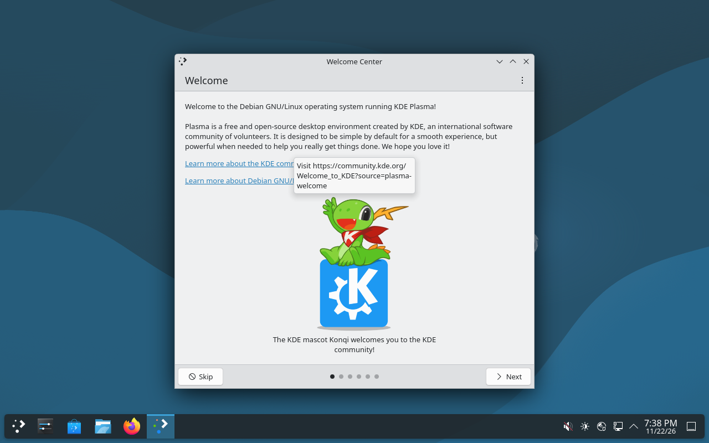
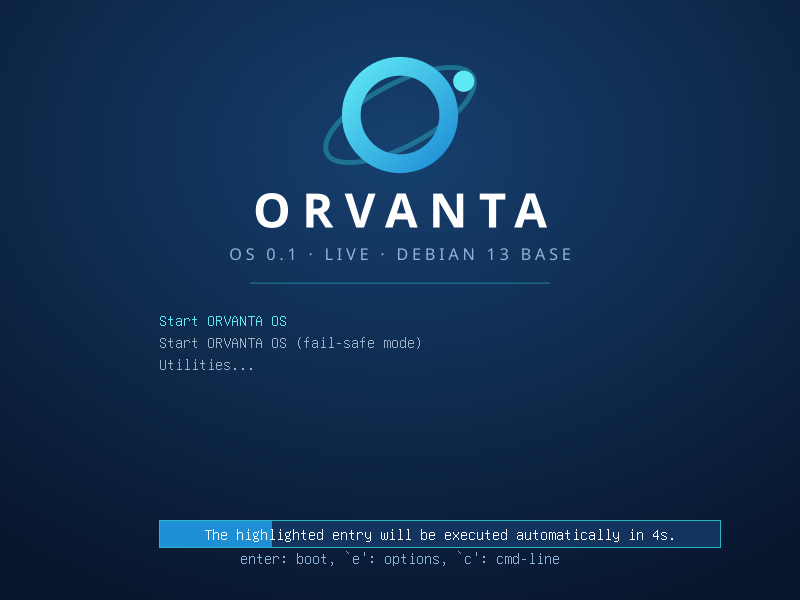
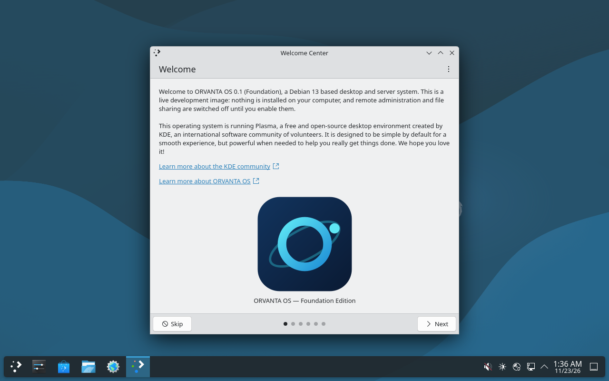
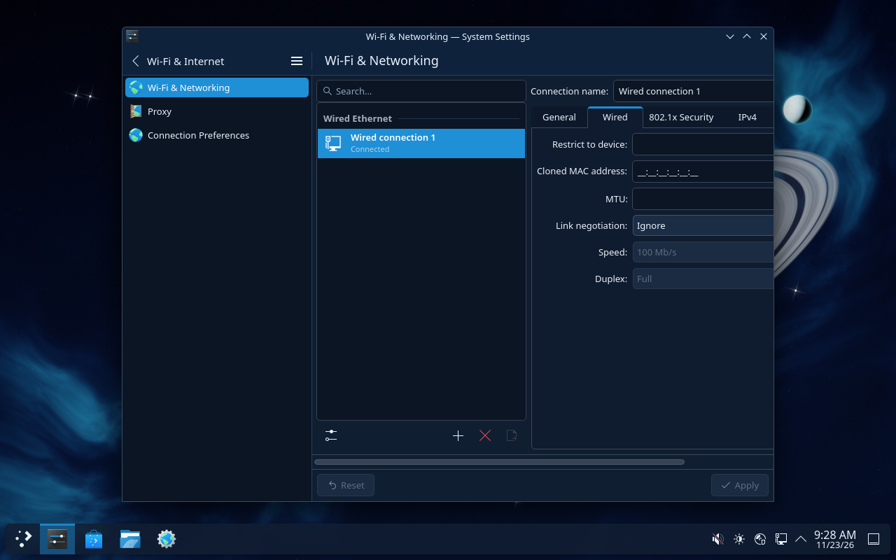

# Build status — 0.1

- [x] Select Debian 13 Trixie amd64 base
- [x] Select KDE Plasma desktop task
- [x] Define initial package list
- [x] Add live-build configuration
- [x] Add host/build/clean scripts
- [x] Verify every listed package is installable on Debian 13 amd64 (2026-11-22, `scripts/check-packages.sh`)
- [x] Live-session hardening: default-deny firewall, remote-admin services masked (2026-11-22)
- [x] Complete a first ISO build (2026-11-22, GitHub Actions run 45052055224, commit 839116c; see below)
- [x] Boot the ISO in a VM: reaches the KDE Plasma desktop in QEMU/KVM, UEFI and BIOS (2026-11-23, `scripts/qemu-smoke-test.sh`)
- [x] Inspect the published ISO offline: checksum, boot records, firewall, masked services (2026-11-23)
- [ ] Boot-test on physical x86-64 hardware (Intel N150 target and one other PC)
- [ ] Validate Secure Boot behaviour (UEFI boot without Secure Boot works in QEMU)
- [x] Verify the firewall and listeners in a running session: inbound probes blocked, restore after flush, link-loss recovery (2026-11-23, `tests/live/run-live-test.sh`; `docs/ROBUSTNESS-2026-11-23.md`)
- [x] In-session storage and access-control tests; fixes for file modes, sysctl hardening, Firewall page, About/Users branding; Control Center 0.1.2 (2026-11-23)
- [ ] Run `tests/live/run-live-test.sh` on the final CI ISO
- [x] Add a Debian 13 CI validation workflow
- [x] CI workflows pass on GitHub Actions (2026-11-22, PR #1, commit 839116c)
- [x] Boot menu starts automatically after 5 s (2026-11-23, tested on a patched 0.1 ISO in QEMU; see below)
- [x] ORVANTA branding on the boot menu and the Plasma Welcome Center (2026-11-23, same test)
- [x] Confirm the boot menu and branding in a full CI ISO build (2026-11-23, run 45096429785, commit e01662d)
- [x] ORVANTA Plasma global theme and wallpaper as the desktop default (2026-11-23, tested on a patched CI ISO in QEMU; see below)
- [ ] Confirm the global theme in a full CI ISO build
- [ ] Brand the login screen (SDDM), Plasma startup splash and kernel boot splash
- [ ] Design installed-system installer
- [ ] Implement Control Center and update agent

- [x] Create ORVANTA Control Center 0.1 read-only Qt prototype
- [x] Confirm `python3-pyside6.qtwidgets` is published for Debian 13 Trixie amd64
- [x] Build, lintian-check and install the Control Center .deb on Debian 13 (0.1.1, 2026-11-22, WSL2)
- [x] Include the Control Center in the ISO (`config/packages.chroot/`)
- [ ] Test on KDE Plasma physical hardware
- [ ] Implement Polkit-mediated privileged backend (separate security review)

## Verification record — 2026-11-22

Environment: Debian GNU/Linux 13 (trixie) amd64 under WSL2 on Windows 11,
live-build 1:20250505+deb13u1, debhelper 13.24.2, lintian 2.122.0+deb13u1,
shellcheck 0.10.0. Full issue list and per-check results:
`docs/REVIEW-2026-11-22.md`.

| Check | Result |
|-------|--------|
| `scripts/validate.sh` (exec bits, sh/bash syntax, shellcheck, py_compile, 6 unit tests, desktop-file-validate, `nft -c`, `lb config`) | Passed |
| `scripts/check-packages.sh` — 37 packages, trixie main/contrib/non-free-firmware | Passed: all installable together (2192-package closure) |
| `dpkg-buildpackage --no-sign` → `orvanta-control-center_0.1.1_all.deb` | Passed |
| `lintian --pedantic` | No tags |
| Install, offscreen launch (5 s), remove | Passed |
| `scripts/build.sh` ISO build (WSL2) | **Not completed.** Control Center `.deb` built, `lb config` and debootstrap completed, package installation started. Stopped manually after ~1.5 h at about 110 of ~2200 packages unpacked: the WSL2 disk image sits on a SATA hard disk with ~70 % I/O stall time. No error was reported up to that point. |

### GitHub Actions — PR #1 (commit 839116c)

| Workflow | Run | Result |
|----------|-----|--------|
| Validate ORVANTA source | [45052055222](https://github.com/souptik1997-lab/OrvantaServerOS/actions/runs/45052055222) | Passed: validate.sh (firewall check required), check-packages.sh, Control Center build, lintian, install + launch |
| Build ORVANTA ISO | [45052055224](https://github.com/souptik1997-lab/OrvantaServerOS/actions/runs/45052055224) | **Passed.** 17:54–18:10 UTC (~16 min, ~13 min of it live-build). Checksum verified by the workflow before upload. |

ISO produced by run 45052055224 (artifact `orvanta-0.1-amd64`, kept until 2026-11-29):

- File: `orvanta-0.1-amd64.hybrid.iso`, 2 996 387 840 bytes
- SHA-256: `1bc4ba9079702ddc8da35419efbd6c689e7e42554be0279aebb3f4c3934c2e73`
- Packages in image: 2267 (`orvanta-0.1-amd64.packages`)
- Kernel: `linux-image-6.12.117+deb13-amd64` 6.12.117-1
- `orvanta-control-center` 0.1.1 installed in the image

The image was built from the live Debian archive; a rebuild on another day
will pick up newer package versions and a different checksum.

Earlier ISO runs on PR #1, in order:

1. 45046185013 (33d4322): failed after `lb build`; log not readable without sign-in.
2. 45048965188 (5e075d5): reported success but produced **no ISO** — the build
   output was piped through `tee` without pipefail. Not a valid result.
3. 45050477378 (55f8311): failed; the new failure annotation showed
   `P: Build completed successfully` followed by `build.sh` not finding the
   ISO: live-build had written `orvanta-0.1-amd64-amd64.hybrid.iso`.
4. 45052055224 (839116c): image name fixed — passed (above).

Details in `docs/REVIEW-2026-11-22.md`, issues 15–17.

## Verification record — 2026-11-23: the published ISO

The artifact from run 45052055224 was downloaded and tested on Debian 13
(WSL2) with QEMU 10.0.13, OVMF 2025.02 and KVM.

| Check | Result |
|-------|--------|
| SHA-256 of `orvanta-0.1-amd64.hybrid.iso` | `1bc4ba90…2e73`, matches the build |
| El Torito boot records | BIOS and UEFI entries present; volume `ORVANTA_0_1`, publisher `ORVANTA PROJECT` |
| `filesystem.squashfs` (mounted read-only) | `nftables.service` enabled; `/etc/nftables.conf` identical to the repository; cockpit.socket/.service, smbd, nmbd, samba-ad-dc, docker.service/.socket, containerd masked; no SSH server; `20auto-upgrades` set to 0; `orvanta-control-center` 0.1.1 `install ok installed` |
| QEMU/KVM, UEFI (OVMF, Secure Boot off), 4 GB RAM | GRUB menu → Enter → KDE Plasma desktop, auto-login, Welcome Center shown within ~3 min |
| QEMU/KVM, BIOS (SeaBIOS) | Same: GRUB menu → KDE Plasma desktop |

Observations: the GRUB menu has no automatic timeout (it waits for Enter);
boot menu and Plasma Welcome Center still show Debian/KDE branding (branding
milestone). The firewall and listening sockets were verified in the image
files, not yet inside a running session.

Not executed: physical hardware, UEFI/Secure Boot, the
installed-system path (no installer exists yet).

## Verification record — 2026-11-23: boot menu timeout and branding

Changes:

- `config/bootloaders/grub-pc/` overrides live-build's GRUB templates (used
  for both BIOS and UEFI): `config.cfg` adds `set timeout=5`; `grub.cfg` names
  the entries "Start ORVANTA OS" / "Start ORVANTA OS (fail-safe mode)" with the
  same kernel, initrd and boot parameters live-build generated before;
  `splash.svg` (rendered by live-build to `splash.png`) and
  `live-theme/theme.txt` give the ORVANTA background, colours and countdown bar.
- Plasma Welcome Center: `/usr/share/plasma/plasma-welcome/intro-customization.desktop`
  (intro text, logo, caption, link) and the logo
  `/usr/share/icons/hicolor/scalable/apps/orvanta.svg`.
- `config/hooks/normal/0200-orvanta-branding.hook.chroot` writes
  `/etc/os-release` as ORVANTA OS 0.1 (`ID=orvanta`, `ID_LIKE=debian`,
  `LOGO=orvanta`), keeping live-build's `IMAGE_ID`/`BUILD_ID`. Debian's
  `/usr/lib/os-release` is not modified; the hook fails the build if it is no
  longer Debian's.

Tests (Debian 13 WSL2, QEMU 10.0.13/KVM):

| Check | Result |
|-------|--------|
| `scripts/validate.sh` with the new checks (both SVGs render with `rsvg-convert`; both GRUB files parse with `grub-script-check` after placeholder substitution; `desktop-file-validate` on the Welcome file; ShellCheck on the new hook) | Passed |
| Branding hook in a trixie chroot | Passed: os-release replaced, `IMAGE_ID`/`BUILD_ID` kept, `/usr/lib/os-release` still Debian |
| Boot test on the 0.1 ISO with the new GRUB files and a branding layer added (GRUB files filled in with live-build's substitutions; Welcome files and the hook's os-release as an extra `/live/*.squashfs` layer), **no key pressed** | UEFI and BIOS: ORVANTA menu with countdown "executed automatically in 4s…", kernel starts by itself, KDE Plasma reached; Welcome Center shows the ORVANTA text, logo and "Learn more about ORVANTA OS" |

Limits: this was a patched copy of the 0.1 ISO, not a fresh `lb build`; the
full build is checked by `build-iso.yml` on PR #1. In BIOS mode the menu is
drawn at 640×480 (live-build's font fallback, unchanged), and GRUB prints
live-build's existing `unicode.pf2 not found` message before it.

## Verification record — 2026-11-23: CI ISO with the boot menu and branding

ISO built by GitHub Actions from commit e01662d
([run 45096429785](https://github.com/souptik1997-lab/OrvantaServerOS/actions/runs/45096429785),
artifact `orvanta-0.1-amd64`, kept until 2026-11-30):

- File: `orvanta-0.1-amd64.hybrid.iso`, 2 996 506 624 bytes
- SHA-256: `daa66e26320aebb4915f87d983c95875636945de0b44bfe190eb90323fad6d29`
- Packages in image: 2267; kernel `linux-image-6.12.118+deb13-amd64` 6.12.118-1
  (newer than the first ISO because the Debian archive moved on);
  `orvanta-control-center` 0.1.1

The artifact was downloaded and tested on Debian 13 (WSL2) with QEMU/KVM and
OVMF, the same tools as above.

| Check | Result |
|-------|--------|
| SHA-256 (`sha256sum -c` with the published `.sha256`) | OK, matches the build |
| `boot/grub/grub.cfg` / `config.cfg` in the ISO | Entries "Start ORVANTA OS", "Start ORVANTA OS (fail-safe mode)", Utilities; no generated "Live system" entries; `set default=0`, `set timeout=5`, `set timeout_style=menu`; no unreplaced `@…@` placeholders; `live-theme/theme.txt` identical to the repository; ORVANTA `splash.png` present |
| `filesystem.squashfs` | `/etc/os-release` is ORVANTA OS 0.1 (`ID=orvanta`, `ID_LIKE=debian`, `LOGO=orvanta`) with live-build's `IMAGE_ID=live` and `BUILD_ID`; `/usr/lib/os-release` still `ID=debian`; logo and Welcome Center file identical to the repository; Control Center installed; nftables enabled; Cockpit, Samba and Docker masked |
| Boot, UEFI (OVMF, Secure Boot off), **no key pressed** | ORVANTA menu with countdown (4 s … 0 s), first entry started by itself, KDE Plasma reached; Welcome Center shows the ORVANTA text, logo, caption and link |
| Boot, BIOS (SeaBIOS), **no key pressed** | Same: ORVANTA menu (640×480) counts down and starts by itself; KDE Plasma and the branded Welcome Center reached |
| `scripts/qemu-smoke-test.sh` (sends no key) | UEFI and BIOS both reach the desktop |

Not executed: physical hardware, Secure Boot, the in-session `nft`/`ss` checks.

## Verification record — 2026-11-23: Plasma global theme and wallpaper

Changes (all in `config/includes.chroot/`):

- `usr/share/plasma/look-and-feel/org.orvanta.desktop/` — global theme
  "ORVANTA": colour scheme ORVANTA Dark, wallpaper ORVANTA, Plasma style
  `default` (Breeze, which follows the colour scheme), Breeze widgets and
  window decoration, `breeze-dark` icons, KDE's default panel layout, previews.
- `usr/share/color-schemes/OrvantaDark.colors` — navy backgrounds, ORVANTA
  blue (#1f8fd6) selection and cyan (#5ee7f5) accents.
- `usr/share/wallpapers/Orvanta/` — photorealistic wallpaper, 3840×2400
  (16:10) and 3840×2160 (16:9) JPEG, rendered by `scripts/render-artwork.py`
  (see "Artwork" below).
- `etc/xdg/kdeglobals` — `LookAndFeelPackage=org.orvanta.desktop`. Debian's
  desktop-base selects "Debian Breeze" from `/usr/share/desktop-base/kf5-settings`,
  which comes after `/etc/xdg` in `XDG_CONFIG_DIRS`; Plasma applies the
  selected theme's defaults at the first login of a new user, as with Debian's.
- The branding hook now fails the build if any of these files is missing or
  if desktop-base's `env.sh` no longer puts `/etc/xdg` first;
  `scripts/validate.sh` renders the wallpapers and cross-checks the theme
  metadata, defaults, colour scheme, wallpaper id and `kdeglobals`.

Tests (Debian 13 WSL2, QEMU/KVM):

| Check | Result |
|-------|--------|
| `scripts/validate.sh` (branding checks required) | Passed |
| Branding hook on the CI ISO's root filesystem plus the new files | Passed |
| CI ISO from e01662d plus the theme files as an extra `/live/*.squashfs` layer, UEFI and BIOS, **no key pressed** | Desktop shows the ORVANTA wallpaper, navy windows and title bars, dark panel; Welcome Center still ORVANTA-branded |

Limits: patched ISO, not a fresh `lb build` (that is the next CI run). Only
the first-login defaults were checked; switching themes in System Settings
and the lock screen were not exercised. (This test used the first, vector
wallpaper; the rendered artwork below replaced it the same day.)

### Artwork

`scripts/render-artwork.py` (numpy + Pillow; Debian `python3-numpy
python3-pil`) renders the wallpaper and the GRUB background with a small
deterministic ray tracer: a ringed ice giant and its moon in front of a
nebula and star field, with soft-terminator lighting, limb darkening,
atmospheric scattering, translucent rings with ringlets and gaps, depth
order and shadows between planet and rings, star point-spread functions and
diffraction spikes, bloom, filmic tone mapping, vignette and grain. Fixed
seeds, so a re-run gives the same images. The outputs are committed; the
build does not run the renderer.

- Wallpaper: `3840x2400.jpg` and `3840x2160.jpg` (Plasma picks by aspect ratio).
- GRUB: `config/bootloaders/grub-pc/splash.svg` embeds the rendered 800×600
  background as a JPEG; the ORVANTA logo and text stay vector, and the lower
  half is kept dark for the menu. live-build still renders the SVG to
  `splash.png`.
- The ORVANTA logo (`orvanta.svg`) stays flat: it is also the application and
  Welcome Center icon and must stay legible at 16–48 px.
- `scripts/validate.sh` checks the JPEG sizes against their names and that
  `splash.svg` embeds a valid 800×600 JPEG.

## Verification record — 2026-11-19

The live-build configuration was corrected to use the current `--binary-images`
option. The unsupported/unverified Secure Boot auto-selection was removed; this
does not add Secure Boot support. A Debian 13 GitHub Actions validation workflow
was added. That record did not claim the workflow, an ISO build or a hardware
boot test had completed. (The 2026-11-22 review found the workflow could not
have passed as written: scripts lacked exec bits and the firmware packages were
checked with only `main` enabled.)
