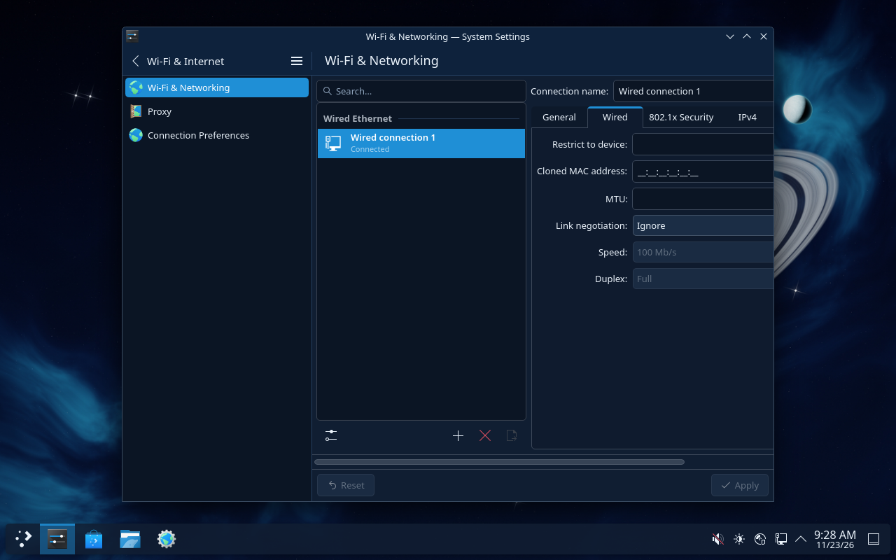
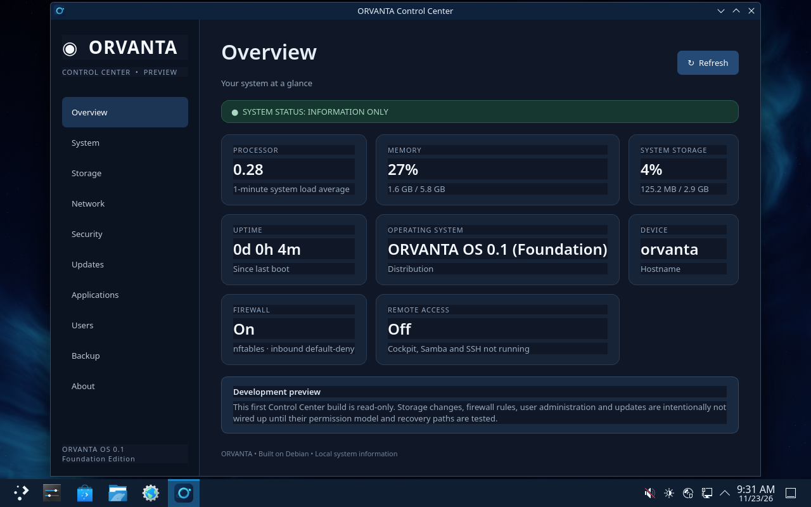
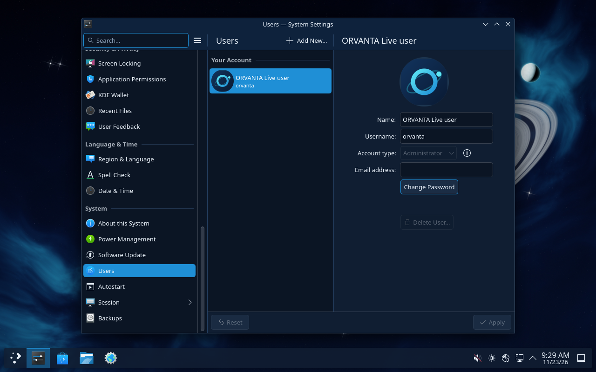
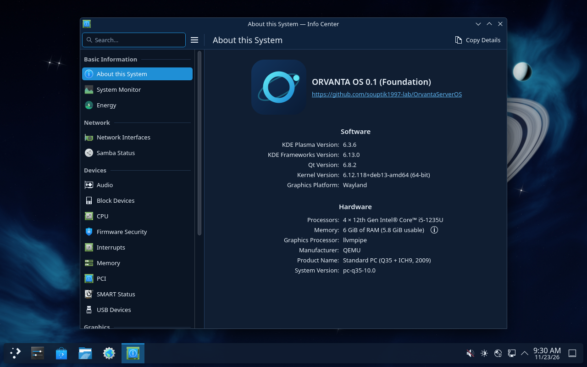
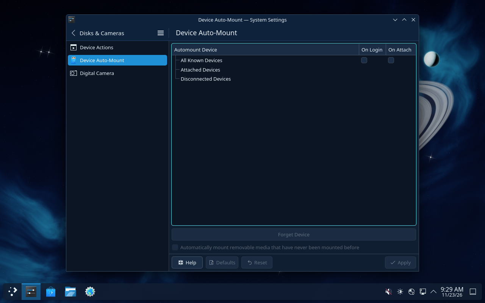
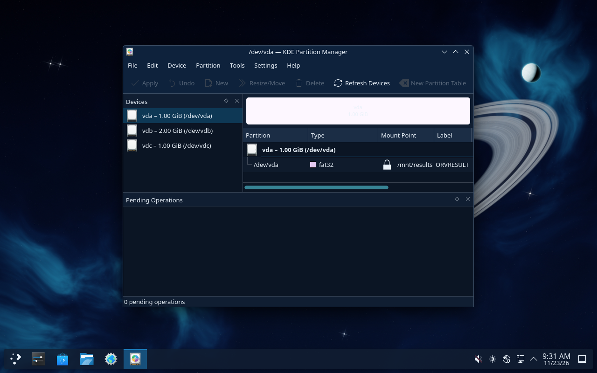
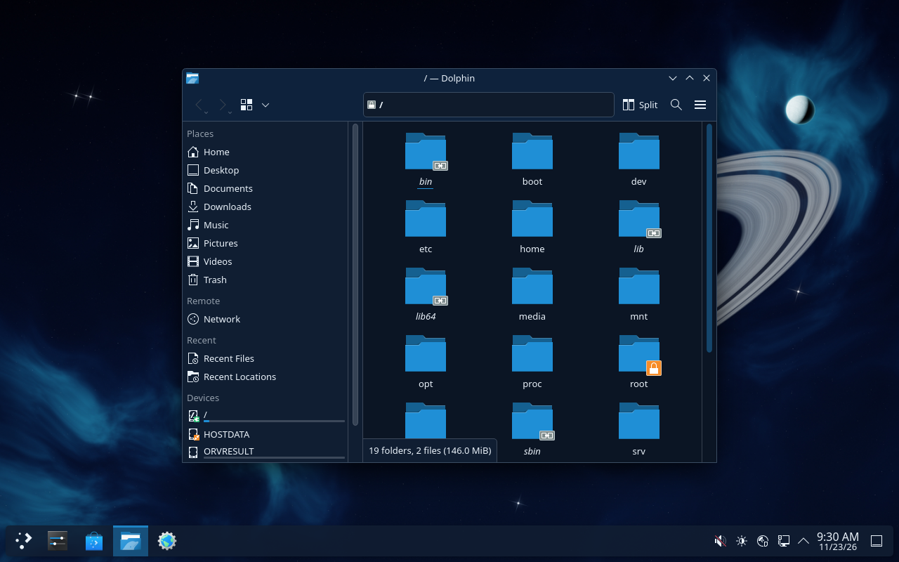
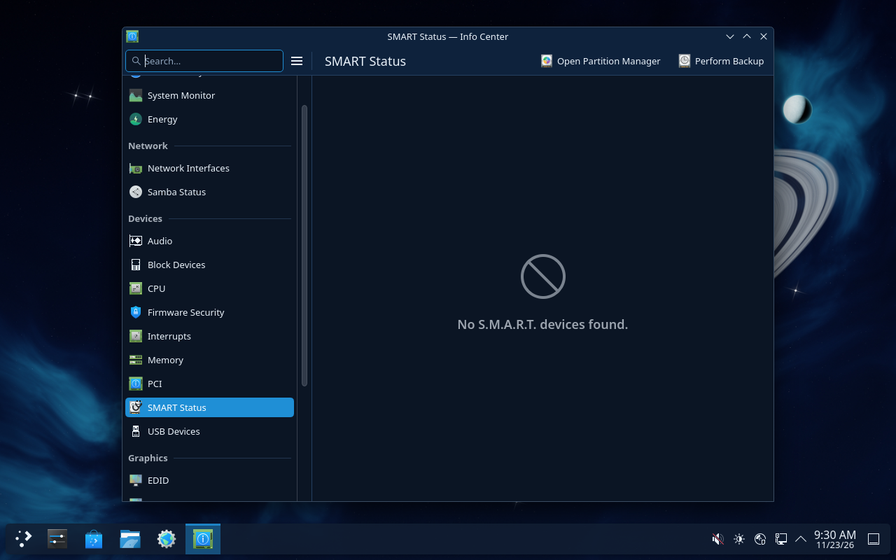

# Robustness test — network, storage and access controls (2026-11-23)

Test of the running ORVANTA 0.1 live session, not just the image files.
Harness: `tests/live/run-live-test.sh` (host, Debian 13 WSL2, QEMU 10.0.13
with KVM, OVMF UEFI, 6 GB RAM) and `tests/live/guest/orvanta-selftest`
(runs as the live user from autostart in a **test-only** extra live layer,
then powers off). No key is pressed at any point.

Image under test: the CI ISO from commit e01662d (run 45096429785) with this
branch's changes layered on top (`OVERLAY_TREE=1`: includes, both chroot
hooks, Control Center 0.1.2). The same harness is to be run on the final CI
ISO (run 45151505531, no overlay): 61 pass, 0 fail; see `BUILD-STATUS.md`.

Extra hardware given to the VM: a blank 2 GB disk (scratch), a 1 GB
"internal" disk with an ext4 partition holding a file plus a swap partition
(simulates a PC's own disk), a results disk, and user-mode networking with
host ports forwarded to guest ports 8080, 9090 (Cockpit) and 445 (Samba).

## Results

Three runs. Run 1 found the issues below; runs 2 and 3 verified the fixes.

| Area | Check | Result |
|------|-------|--------|
| Firewall | Guest starts an HTTP server on all interfaces (port 8080); host probes it every 3 s | **Blocked**: 0 of 6 probes reached it while the firewall was on |
| Firewall | Control: guest deletes the ORVANTA table for 35 s | Host reached the server in 11 of 11 probes, so the probe works |
| Firewall | `systemctl restart nftables`; `nft flush ruleset` then restart; repeated reloads | Table and `policy drop` restored each time; exactly one ORVANTA table |
| Firewall | Ports 9090 (Cockpit) and 445 (Samba) | Never reachable; services masked; `systemctl start cockpit.socket` refused; no SSH server |
| Network | DNS and outbound HTTPS | Work (HTTP 200) |
| Network | Host pulls the virtual cable for 20 s | NetworkManager goes disconnected, reconnects by itself; HTTPS works afterwards |
| Network | Kernel settings (`/proc/sys`) | ICMP redirects not accepted/sent, source routing off, SYN cookies on, `kptr_restrict=1`, `dmesg_restrict=1`; unprivileged `dmesg` refused |
| Storage | Internal disk | Not mounted automatically; its swap partition not used |
| Storage | Live medium | Read-only |
| Storage | Partition, `mkfs.ext4`, mount via udisks as the desktop user, write 200 MB, remount, checksum, `e2fsck -fn` | Identical checksum; filesystem clean |
| Storage | LUKS2 volume: format, open, mkfs, write, close; wrong passphrase | Works; wrong passphrase rejected |
| Access | Second, unprivileged user (`tester`) | Cannot read `/etc/shadow`, use sudo, read/change the firewall, read the live user's home (mode 700), write `/etc`, stop the firewall, mount disks, or add system network connections |
| Access | root | Password locked |
| Access | World-writable files in `/etc`, `/usr` | None (after fix 1) |
| Access | ORVANTA files | `644 root:root` |
| UI | Live user name and avatar, About page, Control Center firewall card | ORVANTA (after fixes 3–5) |

Known and accepted (live image only, documented in the README): the live
user has live-config's public password and passwordless sudo. The firewall
and masked services are what protect the live session.

## Issues found and changed

1. **Permissions depended on the build checkout.** Run 1 used a tree copied
   from a Windows drive: all 15 ORVANTA files in the image were mode 777. A
   checkout with umask 002 would ship group-writable files the same way.
   The hardening hook now sets `root:root`, 0644/0755 on every ORVANTA path
   and its parent directories, and **fails the build** if any file under
   `/etc` or `/usr` is world-writable or a directory is world-writable without
   the sticky bit. Verified both ways: a 777 tree is repaired; a foreign
   world-writable file stops the build.
2. **Kernel network defaults.** Linux accepts and sends ICMP redirects by
   default and shows kernel pointers. Added
   `/etc/sysctl.d/60-orvanta-hardening.conf` (redirects, source routing,
   SYN cookies, `kptr_restrict`, `dmesg_restrict`); `validate.sh` checks every
   key exists.
3. **Misleading Firewall page.** Plasma's System Settings → Firewall only
   manages ufw or firewalld, so it said "Please install a firewall" and
   "Firewall is disabled" while nftables was blocking everything. It is now
   hidden (`[KDE Control Module Restrictions] kcm_firewall=false` in
   `/etc/xdg/kdeglobals`), and the ORVANTA Control Center shows the nftables
   state instead.
4. **Control Center 0.1.2.** New read-only Firewall and Remote access cards
   (via unprivileged `systemctl is-active`/`is-enabled`); desktop file name
   and window icon set, so Plasma shows the ORVANTA icon instead of the
   generic Wayland icon; the package now ships the current logo (it carried an
   older design).
5. **Debian identity in panels.** "About this System" showed "ORVANTA OS 13"
   with the Debian logo (Debian's `/etc/xdg/kcm-about-distrorc`), and Users
   showed "Debian Live user" with Debian's avatar. Now: ORVANTA logo and
   "0.1 (Foundation)", "ORVANTA Live user"
   (`/etc/live/config.conf.d/orvanta.conf`), ORVANTA avatar (`/etc/skel/.face`).

## Not changed, with reasons

- **AppArmor in the live session.** The kernel has AppArmor active and 116
  profiles are installed, but Debian's `apparmor.service` deliberately does
  not load profiles on a live system using overlayfs
  (`ConditionPathExists=!/run/live/overlay/work`), because path mediation
  does not match the overlay. Forcing it could break applications; kept
  Debian's behaviour. Profiles load on an installed system (installer not
  written yet). README corrected.
- **`kernel.yama.ptrace_scope=0`** (Debian default) left unchanged: raising it
  breaks attaching debuggers; revisit for the installed server profile.
- **KDE Connect** may listen on TCP/UDP 1716 on all interfaces; inbound is
  dropped by the firewall.

## Control panels

| | |
|---|---|
|  |  |
| Wi-Fi & Networking (NetworkManager): wired connection up | ORVANTA Control Center 0.1.2: firewall On, remote access Off |
|  |  |
| Users: ORVANTA Live user, administrator (sudo) | About this System: ORVANTA OS 0.1 (Foundation) |
|  |  |
| Disks & Cameras → Device Auto-Mount: nothing mounted automatically | KDE Partition Manager: test disks listed; changes need authentication |
|  |  |
| Dolphin: internal disk (HOSTDATA) listed, not mounted | Info Center → SMART Status (virtual disks have no SMART) |

The Firewall page itself is no longer reachable (fix 3); opening
`systemsettings kcm_firewall` shows the System Settings start page.

Not covered: physical hardware, Wi-Fi, Secure Boot, the installed system.
